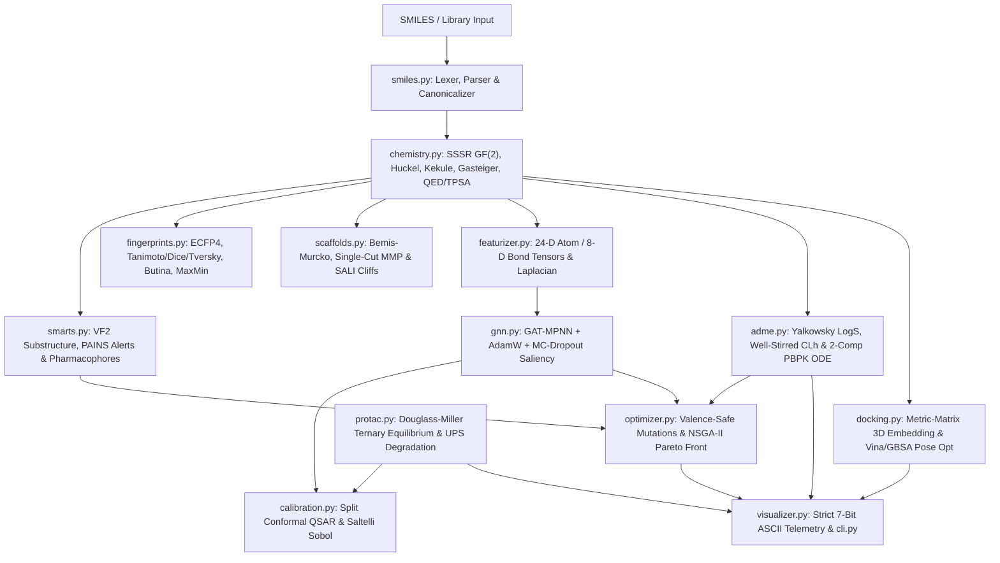
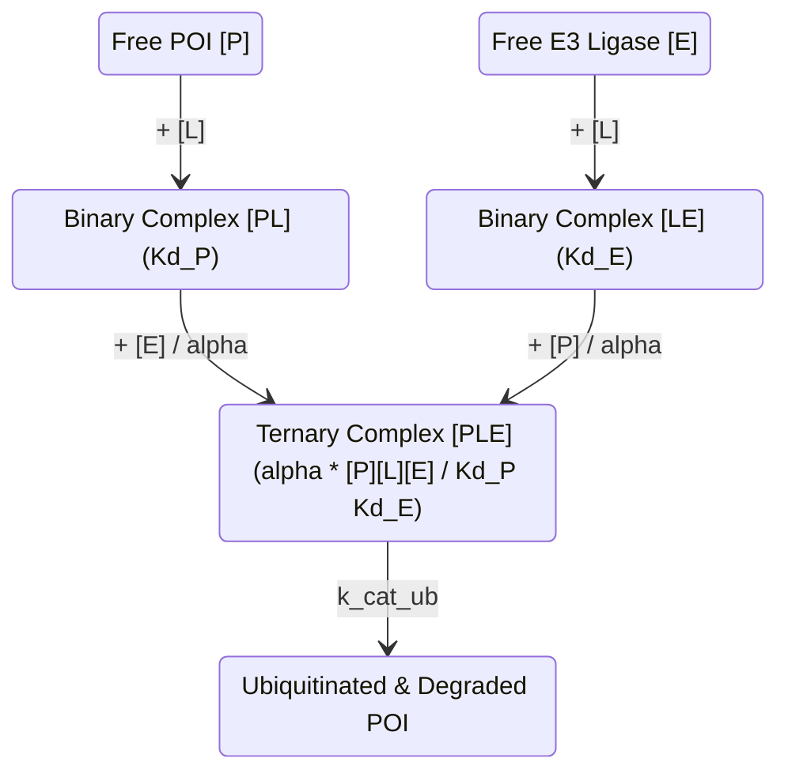

# MolAlembic

[](https://github.com/ZengLLQ/mol-alembic/actions/workflows/ci.yml)


**MolAlembic** is a self-contained computational drug discovery, cheminformatics, and molecular simulation platform built strictly on Python, NumPy, and SciPy. It unifies SMILES/SMARTS molecular graph perception, exact Smallest Set of Smallest Rings (SSSR) and Huckel aromaticity analysis, circular ECFP/Morgan fingerprinting, Bemis-Murcko scaffold and Matched Molecular Pair (MMP) activity-cliff mining, an analytical-backpropagation Graph Attention Message Passing Neural Network (GAT-MPNN) with split conformal uncertainty quantification, multitask ADME and 2-compartment PBPK ODE simulation, 3D distance-geometry conformer embedding with empirical Vina/GBSA docking, Douglass-Miller PROTAC ternary complex cooperativity kinetics, and NSGA-II multi-objective *de novo* molecular optimization.

---

## System Architecture



### Module Dependency Map

| Module | Primary Responsibility | Key Classes & Entry Points |
| :--- | :--- | :--- |
| `mol_alembic.types` | Periodic constants, domain exceptions, typed dataclasses | `Atom`, `Bond`, `Molecule`, `ELEMENT_TABLE`, `ADMEProfile`, `DockingPoseResult` |
| `mol_alembic.smiles` | Recursive SMILES lexer, `%nn` rings, implicit H, canonicalizer | `parse_smiles`, `to_smiles`, `validate_smiles_roundtrip`, `BENCHMARK_MOLECULES` |
| `mol_alembic.chemistry` | Horton/GF(2) SSSR, Huckel $4n+2$, Kekulization, Gasteiger, QED | `perceive_sssr`, `kekulize_molecule`, `compute_gasteiger_charges`, `analyze_molecule` |
| `mol_alembic.smarts` | Logical SMARTS AST compiler, VF2 backtracking, PAINS alerts | `compile_smarts`, `match_smarts`, `screen_structural_alerts`, `annotate_pharmacophores` |
| `mol_alembic.fingerprints` | Morgan ECFP circular hashes, torsion keys, Butina, MaxMin | `morgan_fingerprint_counts`, `morgan_bit_vector`, `butina_clustering`, `maxmin_diversity_selection` |
| `mol_alembic.scaffolds` | Bemis-Murcko frameworks, single-cut MMPs, SALI activity cliffs | `extract_bemis_murcko_scaffold`, `single_cut_fragments`, `find_matched_molecular_pairs` |
| `mol_alembic.featurizer` | 24-D atom / 8-D bond matrices, normalized Laplacian, batching | `featurize_molecule`, `collate_graph_batch` |
| `mol_alembic.gnn` | Pure-NumPy GAT-MPNN, analytical gradients, AdamW, MC-dropout | `GNNConfig`, `MolecularGraphNet` |
| `mol_alembic.adme` | Yalkowsky $\log S$, Caco-2, $\log \text{BB}$, well-stirred $CL_h$, RK45 PBPK | `predict_adme`, `simulate_pbpk_2comp`, `score_adme_desirability` |
| `mol_alembic.docking` | MDS distance geometry 3D embedding, BFGS strain, 6-DOF Powell docking | `embed_3d_conformer`, `score_ligand_pose`, `dock_ligand`, `default_kinase_pocket` |
| `mol_alembic.protac` | Douglass-Miller cubic/Brent ternary equilibrium & UPS ODE | `solve_ternary_equilibrium`, `sweep_protac_hook_effect`, `estimate_linker_cooperativity` |
| `mol_alembic.optimizer` | Valence-safe SMILES graph mutations & NSGA-II crowding sort | `generate_molecular_neighbors`, `nsga2_rank_and_crowding`, `optimize_molecules` |
| `mol_alembic.calibration` | Split conformal intervals, ECFP4 Ridge baseline, Saltelli Sobol | `calibrate_conformal_qsar`, `evaluate_ridge_ecfp_baseline`, `protac_sobol_audit` |
| `mol_alembic.visualizer` | Strict 7-bit ASCII cards, heatmaps, saliency, PK, Hook & Pareto plots | `render_molecule_card`, `render_pbpk_curve`, `render_protac_hook_curve`, `render_pareto_scatter` |
| `mol_alembic.pipeline` | End-to-end discovery campaign orchestrators | `run_qsar_screen`, `run_adme_pk_campaign`, `run_docking_campaign`, `run_protac_campaign` |
| `mol_alembic.cli` | `argparse` CLI (`mol-alembic` / `python -m mol_alembic.cli`) | `main` (`demo`, `screen`, `adme`, `dock`, `protac`, `optimize`) |

---

## Mathematical Formulations & Physical Invariants

### 1. Ring Perception (SSSR) & Aromaticity

Given a molecular graph $G = (V, E)$ with $C$ connected components, the cyclomatic number (dimension of the cycle space over $\mathbb{F}_2$) is strictly:

$$\nu(G) = |E| - |V| + C$$

`perceive_sssr` generates Horton shortest-path cycle candidates from BFS trees rooted at every atom and selects the minimum-length linearly independent cycle basis via $\mathbb{F}_2$ Gaussian elimination over edge bitmasks. Each ring is evaluated against Huckel's planar $\pi$-electron rule:

$$N_\pi = 4n + 2 \quad (n \in \mathbb{Z}_{\ge 0})$$

Aromatic systems are subsequently Kekulized via exact backtracking maximum matching over $sp^2$ atoms requiring localized $\pi$-bonds, guaranteeing intact tetravalent carbon stoichiometry ($\sum_e \text{order}(e) + H_i = 4$).

### 2. Gasteiger-Marsili Partial Charge Equalization

Orbital electronegativity $\chi_i$ varies quadratically with atomic charge $q_i$:

$$\chi_i(q_i) = a_i + b_i q_i + c_i q_i^2$$

Across each covalent bond $(i, j)$ at damping step $t \in \{1,\dots,8\}$ with $\alpha_t = 2^{-t}$, charge transfers from the less electronegative donor $d$ to acceptor $a$ normalized by the positive-ion limit $\chi_d^+ = a_d + b_d + c_d$:

$$\Delta q_{d \to a}^{(t)} = 2^{-t} \frac{\chi_a(q_a^{(t-1)}) - \chi_d(q_d^{(t-1)})}{\chi_d^+}$$

Net molecular formal charge is strictly conserved across all heavy atoms:

$$\left| \sum_{i \in V} q_i - \sum_{i \in V} q_i^{\text{formal}} \right| < 10^{-11}$$

### 3. Drug-Likeness (Bickerton QED) & Activity Cliffs (SALI)

Quantitative Estimate of Drug-likeness combines eight Asymmetric Double Sigmoidal (ADS) desirability functions $d_k(x_k) \in (0, 1]$ with empirically calibrated weights $w_k$:

$$\text{QED} = \exp\left(\frac{\sum_{k=1}^{8} w_k \ln d_k(x_k)}{\sum_{k=1}^{8} w_k}\right)$$

Across single-cut Matched Molecular Pairs sharing an identical core scaffold, Structure-Activity Landscape Index (SALI) flags steep activity cliffs:

$$\text{SALI}(A, B) = \frac{|\text{pIC}_{50}(A) - \text{pIC}_{50}(B)|}{\max(0.02,\, 1 - T(A, B))}$$

where $T(A, B) = \frac{\mathbf{f}_A \cdot \mathbf{f}_B}{\|\mathbf{f}_A\|_2^2 + \|\mathbf{f}_B\|_2^2 - \mathbf{f}_A \cdot \mathbf{f}_B}$ is the ECFP4 Tanimoto similarity.

### 4. Graph Attention Message Passing Neural Network (GAT-MPNN)

Each molecular graph carries node features $X \in \mathbb{R}^{N \times 24}$, directed edge features $E \in \mathbb{R}^{2M \times 8}$, and symmetric normalized augmented adjacency:

$$\hat{A} = D^{-1/2}(A + I)D^{-1/2}, \qquad D_{ii} = 1 + \sum_j A_{ij}$$

At layer $\ell$, edge-conditioned attention coefficients $\alpha_{ji}^{(\ell)}$ weight incoming neighbor messages alongside a spectral smoothing skip term:

$$e_{ji}^{(\ell)} = \text{LeakyReLU}\!\left(\mathbf{a}^{(\ell)\top}\big[h_i^{(\ell)} \,\|\, h_j^{(\ell)} \,\|\, e_{ji}\big]\right), \qquad \alpha_{ji}^{(\ell)} = \frac{\exp(e_{ji}^{(\ell)})}{\sum_{k \in \mathcal{N}(i)} \exp(e_{ki}^{(\ell)})}$$

$$h_i^{(\ell+1)} = h_i^{(\ell)} + \text{SiLU}\!\left(W_{\text{self}}^{(\ell)} h_i^{(\ell)} + 0.65 \sum_{j \in \mathcal{N}(i)} \alpha_{ji}^{(\ell)} \big(W_{\text{nbr}}^{(\ell)} h_j^{(\ell)} + W_{\text{edge}}^{(\ell)} e_{ji} + b^{(\ell)}\big) + 0.35 (\hat{A} H^{(\ell)} W_{\text{nbr}}^{(\ell)})_i\right)$$

Gated global attention pooling produces normalized atom-level saliency attributions $g_i$ ($\sum_i g_i = 1$). Exact analytical gradients $\nabla_\theta \mathcal{L}$ are verified against central finite differences to $< 10^{-4}$ relative tolerance and updated via decoupled AdamW with cosine learning-rate annealing.

### 5. Well-Stirred Hepatic Clearance & 2-Compartment PBPK ODEs

Aqueous solubility follows the Yalkowsky General Solubility Equation ($\log S = 0.5 - \log P - 0.01(T_m - 25)$), and hepatic blood clearance follows the well-stirred liver model with $Q_h = 20.7\;\text{mL/min/kg}$:

$$CL_h = Q_h \frac{f_{u,p}\, CL_{\text{int}}}{Q_h + f_{u,p}\, CL_{\text{int}}}$$

Oral and IV disposition are integrated via adaptive RK45 over the exact mass-conserving 4-state ODE system $[A_g, A_c, A_p, A_{\text{elim}}]$:

$$\frac{dA_g}{dt} = -k_a A_g, \quad \frac{dA_c}{dt} = k_a A_g - (k_{10} + k_{12}) A_c + k_{21} A_p, \quad \frac{dA_p}{dt} = k_{12} A_c - k_{21} A_p, \quad \frac{dA_{\text{elim}}}{dt} = k_{10} A_c$$

guaranteeing $A_g(t) + A_c(t) + A_p(t) + A_{\text{elim}}(t) = A_{\text{bioavail}}(0)$ to $< 10^{-8}\;\text{mg}$.

### 6. 3D Distance Geometry & Empirical Vina/GBSA Docking

Interatomic distance bounds $[l_{ij}, u_{ij}]$ from 1-2 covalent lengths and 1-3 bond angles undergo triangle-inequality Floyd-Warshall smoothing, classical MDS metric-matrix embedding, and BFGS geometric strain minimization. Pose optimization searches 6-DOF rigid-body transformations $(t_x, t_y, t_z, \phi, \theta, \psi)$ via Powell restarts against Vina steric Gauss1/Gauss2, quadratic repulsion, hydrophobic contact, directional H-bond, torsional entropy ($0.29\,N_{\text{rot}}$), and Still GBSA desolvation terms.

### 7. Douglass-Miller PROTAC Ternary Equilibrium & Hook Effect



Given total target $[P]_0$, E3 ligase $[E]_0$, PROTAC $[L]_0$, binary dissociation constants $K_{d,P}, K_{d,E}$, and cooperativity $\alpha$:

$$[PL] = \frac{[P][L]}{K_{d,P}}, \qquad [LE] = \frac{[L][E]}{K_{d,E}}, \qquad [PLE] = \frac{\alpha [P][L][E]}{K_{d,P} K_{d,E}}$$

Eliminating $[P]$ and $[E]$ yields a monotonic scalar root equation in $[L]$ solved via Brent's method (`brentq`) to $< 10^{-10}\;\text{nM}$ mass-balance residual across all concentrations, capturing the characteristic bell-shaped **Hook Effect** peak near $[L]_{\text{peak}} \approx \sqrt{K_{d,P} K_{d,E}}$ and catalytic degradation $DC_{50}, D_{\max}$.

---

## Installation & Quick Start

```bash
git clone https://github.com/ZengLLQ/mol-alembic.git
cd mol-alembic
pip install -e .[dev]
```

Run the full verification suite:

```bash
python -m compileall -q src
flake8 src tests examples --max-line-length=120 --extend-ignore=E203
mypy src
pytest -v
```

---

## CLI Reference

MolAlembic installs the `mol-alembic` console script (and supports `python -m mol_alembic.cli`):

```bash
# 1. Integrated end-to-end discovery workflow (QSAR, ADME/PBPK, Docking, PROTAC, NSGA-II)
mol-alembic demo --seed 42

# 2. Library QSAR screening: Butina clustering, MMP/SALI cliffs, Ridge vs GAT-MPNN conformal
mol-alembic screen --epochs 24 --sim-cutoff 0.30 --seed 42

# 3. Physicochemical card & 2-compartment oral PBPK ODE simulation
mol-alembic adme --smiles "COc1cc2ncnc(Nc3ccc(F)c(Cl)c3)c2cc1OCC" --name Gefitinib_Motif --dose-mg 250

# 4. 3D distance-geometry conformer embedding & Vina/GBSA empirical docking
mol-alembic dock --smiles "COc1cc2ncnc(Nc3ccc(F)c(Cl)c3)c2cc1OCC" --seed 11

# 5. PROTAC ternary equilibrium Hook-effect sweep & Saltelli Sobol sensitivity
mol-alembic protac --kd-poi-nm 12.0 --kd-e3-nm 35.0 --alpha 8.5

# 6. NSGA-II multi-objective de novo molecular optimization
mol-alembic optimize --smiles "COc1cc2ncnc(Nc3ccc(F)c(Cl)c3)c2cc1OCC" --generations 5 --pop-size 12 --seed 19
```

---

## Python SDK Walkthrough

```python
from mol_alembic import (
    analyze_molecule,
    build_sar_benchmark_dataset,
    calibrate_conformal_qsar,
    dock_ligand,
    optimize_molecules,
    parse_smiles,
    predict_adme,
    simulate_pbpk_2comp,
    sweep_protac_hook_effect,
)

# 1. Molecular perception & descriptors
mol = parse_smiles("COc1cc2ncnc(Nc3ccc(F)c(Cl)c3)c2cc1OCC", name="Gefitinib_Motif")
rings, desc = analyze_molecule(mol)
print(desc.formula, desc.molecular_weight, desc.crippen_logp, desc.tpsa, desc.qed)

# 2. ADME & 2-compartment PBPK ODE
adme = predict_adme(mol)
pk = simulate_pbpk_2comp(mol, adme=adme, dose_mg=250.0, duration_h=24.0)
print(f"Cmax={pk.cmax_mg_l} mg/L, AUC={pk.auc_0_inf_mg_h_l}, mass_err={pk.mass_balance_error:.2e}")

# 3. 3D conformer embedding & empirical docking
pose = dock_ligand(mol, seed=11)
print(f"Docking={pose.total_score_kcal_mol} kcal/mol, LE={pose.ligand_efficiency}")

# 4. Split-conformal GAT-MPNN & NSGA-II de novo optimization
_, smiles_list, activities = build_sar_benchmark_dataset(seed=42)
gnn, conf = calibrate_conformal_qsar(smiles_list, activities, epochs=24, seed=42)
pareto = optimize_molecules(mol.smiles, gnn, generations=4, pop_size=12, seed=42)
print(f"Pareto front size: {len(pareto.pareto_front)}")

# 5. PROTAC ternary Hook effect
sweep = sweep_protac_hook_effect(kd_poi_nm=12.0, kd_e3_nm=35.0, alpha=8.5)
print(f"Peak [PLE]={sweep.peak_ple_nm} nM, DC50={sweep.dc50_nm} nM, Dmax={sweep.dmax}")
```

---

## Standalone Examples

Run all four standalone example scripts under `examples/`:

```bash
python examples/01_smiles_chemistry_and_scaffolds.py
python examples/02_gnn_qsar_and_conformal_screening.py
python examples/03_adme_pbpk_and_docking_pose.py
python examples/04_protac_ternary_and_denovo_mpo.py
```

---

## Sample 7-Bit ASCII Terminal Telemetry

All terminal visualizations strictly emit 7-bit ASCII characters (`0x00..0x7F`) for zero-error rendering across Windows `cp1252` and headless CI consoles:

```text
+--------------------------------------------------------------------------------+
| MolAlembic Card: Gefitinib_Motif        Formula: C17H15ClFN3O2                |
| SMILES: COc1cc2ncnc(Nc3ccc(F)c(Cl)c3)c2cc1OCC                                  |
+--------------------------------------------------------------------------------+
| MW:  347.77 | LogP:  3.76 | TPSA:  56.27 A^2 | QED: 0.761 | SA: 2.42 |
| HBD:  1 | HBA:  5 | RotB:  5 | Rings:  3 (Arom: 3) | Wiener: 1358       |
| Ro5 Viol: 0 | Veber Viol: 0 | PAINS Alerts: 0  | Balaban J:   1.614      |
+--------------------------------------------------------------------------------+
| ADME logS:  -4.42 | Papp:  108.2 nm/s | Fa: 0.630 | logBB:  -0.12         |
| fu,p: 0.029 | CLh:   1.11 mL/min/kg | Vd:  4.43 L/kg | t1/2:  46.04 h     |
+--------------------------------------------------------------------------------+

PROTAC Hook Effect (*=[PLE] nM, .=Degrad) Peak=43.00 nM @ 100.0 nM | DC50=7.66 nM
   43.00 |                               ****                       |
   39.09 |                               ....*                      |
   35.18 |                            ..*     *.....                |
   31.27 |                           . *       *    ..              |
   27.36 |                          .           *     .             |
   23.45 |                        ..  *          **    .            |
   19.54 |                       .                 *    ..          |
   15.63 |                      .    *              **    ..        |
   11.73 |                    ..    *                 *     .       |
    7.82 |                   .   ***                   ***   ..     |
    3.91 |              ..... ***                         **** .....|
    0.00 |********************                                ******|
         +----------------------------------------------------------+
         10^-2.0 nM                                        10^+5.0 nM
```

---

## Verification & Conservation Benchmarks

| Verification Gate / Conservation Law | Observed Result |
| :--- | :--- |
| Automated Test Suite (`pytest -v`) | **39 / 39 passed** across 5 suites |
| Static Type Checking (`mypy src`, `disallow_untyped_defs`) | **0 errors** across 17 source modules |
| Style & Lint (`flake8 src tests examples --max-line-length=120`) | **0 issues** |
| Gasteiger Formal Charge Conservation ($\|\sum q_i - Q\|$) | $< 10^{-16}$ (verified across neutral, anionic, cationic, zwitterionic ligands) |
| 2-Compartment PBPK RK45 Mass Conservation | $8.53 \times 10^{-14}\;\text{mg}$ max residual over $24\;\text{h}$ |
| Douglass-Miller PROTAC Ternary Mass Conservation | $< 2 \times 10^{-10}\;\text{nM}$ max residual across $10^{-2}$ to $10^{5}\;\text{nM}$ |
| GAT-MPNN Analytical vs. Finite-Difference Gradients | Relative match within $10^{-4}$ across all input, attention, edge, gate & MLP tensors |
| 6-Matrix CI Coverage (`ubuntu`, `macos`, `windows` x `3.11`, `3.12`) | Bytecode compile, lint, mypy, pytest, 6 CLI commands & 4 examples |

---

## Architectural Trade-Offs & Known Limitations

- **Pure-Python / NumPy / SciPy Execution**: Implementing graph perception, GAT-MPNN backpropagation, and distance geometry directly in NumPy/SciPy eliminates heavy native C++/CUDA binary build fragility (`RDKit`, `PyTorch`, `CUDA`) across Windows/macOS/Linux CI matrices, trading multi-GPU million-compound throughput for deterministic portability on hit-to-lead series ($10^1\text{--}10^3$ ligands).
- **Rigid-Body Pose Optimization & Empirical Pocket**: `dock_ligand` optimizes 6-DOF rigid-body pose over a distance-geometry embedded conformer against a parametric binding site rather than full receptor side-chain molecular dynamics or torsion-tree conformational sampling.
- **QSAR & ADME Calibration Scope**: Built-in `BENCHMARK_MOLECULES` ($N=24$) demonstrates split conformal calibration and GAT-MPNN learning on small-molecule scaffolds; prospective medicinal chemistry campaigns should supply assay-specific $\text{pIC}_{50}/\text{p}K_i$ training sets ($N \ge 100$).
- **Research Scope Disclaimer**: MolAlembic is a computational chemistry research and simulation tool and is **not** validated or certified for clinical diagnosis, regulatory submission, or human dosing decisions.
